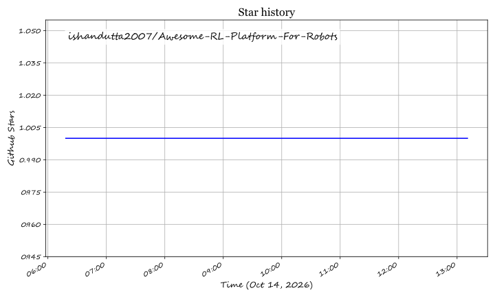

<div align="center">



# 🤖 Awesome RL Platform For Robots

### Curated Directory of SaaS Products, Distributed RL Frameworks & GPU Simulation Platforms for Robot Learning

<p align="center">
  <a href="https://github.com/ishandutta2007/Awesome-Awesome-Awesome"></a><a href="https://discord.gg/jc4xtF58Ve"></a>
  <a href="https://github.com/ishandutta2007/Awesome-RL-Platform-For-Robots/stargazers"></a>
  <a href="https://github.com/ishandutta2007/Awesome-RL-Platform-For-Robots/network/members"></a>
  <a href="https://github.com/ishandutta2007/Awesome-RL-Platform-For-Robots/blob/main/LICENSE"></a>
  <a href="https://github.com/ishandutta2007/Awesome-RL-Platform-For-Robots/pulls"></a>
  <a href="https://github.com/ishandutta2007"></a>
</p>

<p align="center">
  <b>A comprehensive, SEO-optimized knowledge repository tracking category-defining reinforcement learning (RL) infrastructure, physics simulation engines, sim-to-real transfer pipelines, and distributed policy training platforms for robotics.</b>
</p>

</div>

---

## 📌 Table of Contents

- [🔍 Sector Overview & Market Dynamics](#-sector-overview--market-dynamics)
- [☁️ SaaS & Hosted Platforms](#️-saas--hosted-platforms)
- [💻 Open-Source GitHub Projects](#-open-source-github-projects)
  - [Top Projects by Community Adoption](#top-projects-by-community-adoption)
- [🧩 Framework Synergy & Architectural Blueprint](#-framework-synergy--architectural-blueprint)
- [🤝 How to Contribute](#-how-to-contribute)
- [💖 Support & Community](#-support--community)
- [📈 Star History](#-star-history)
- [⚖️ Disclaimer](#️-disclaimer)

---

## 🔍 Sector Overview & Market Dynamics

The global **Reinforcement Learning (RL) and Autonomous Robotics Simulation software market** is experiencing unprecedented acceleration, valued at approximately **$16.2 billion in 2026** and projected to surpass **$110+ billion by 2033** at a Compound Annual Growth Rate (**CAGR of ~31.6%**).

Market structure and dynamics in this domain reflect a **concentrated core compute foundation with a moderately fragmented upper application layer**:
- **Massively Parallel Compute & Physics (Concentrated / Winner-Take-Most):** High barrier-to-entry GPU simulation runtimes and hyperscale distributed clustering are heavily concentrated around industry anchors like NVIDIA (Isaac Sim, Isaac Lab, Omniverse) and scalable distributed runtimes (Ray / Anyscale, PyTorch Foundation).
- **Environment Tooling & Sim-to-Real Transfer (Moderately Fragmented):** The ecosystem of robotic morphology benchmarks, contact-rich manipulation tasks, sensor fusion platforms, and offline dataset formats remains actively fragmented across specialized research labs, open-source consortiums (Farama Foundation, DeepMind, Hugging Face LeRobot), and domain-specific robotics startups.

---

## ☁️ SaaS & Hosted Platforms

The table below tracks commercial SaaS and hosted platforms providing cloud compute, observability, distributed cluster orchestration, and simulation for robot reinforcement learning. Products are sorted in **descending order by company size** (market capitalization / enterprise valuation).

| 🏢 Platform / Service | 💼 Company & Valuation / Revenue | 💵 Starting Tier Pricing | 🎁 Free Tier / Trial Limits | 🚀 Primary RL & Robotics Capability |
| :--- | :--- | :--- | :--- | :--- |
| **[NVIDIA Omniverse Cloud / Isaac Sim](https://developer.nvidia.com/isaac-sim)** | **NVIDIA**<br>• Market Cap: ~$3.2 Trillion<br>• Revenue: ~$120B+ ARR | **$1.00 / GPU-hour** (pay-as-you-go via AWS/Azure CSP marketplace) or **$4,500 / GPU / year** (NVIDIA AI Enterprise subscription) | **Free forever for individual developers** via NVIDIA Developer Program (full local workstation Isaac Sim/Lab engine); Cloud evaluation offers a **30-day trial with 16 GPU-hours** | Photorealistic, GPU-accelerated rigid-body physics simulation, synthetic data generation (SDG), multi-sensor rendering, and direct Isaac Lab reinforcement learning policy training. |
| **[Weights & Biases](https://wandb.ai/)** | **Weights & Biases**<br>• Valuation: ~$1.25 Billion (Series C)<br>• Revenue: ~$100M+ ARR | **$60 / month** (Pro plan, up to 10 team seats) or **$50 / user / month** (billed annually) | **Free forever Personal Plan**: Includes up to **5 user seats, 5 GB cloud storage/month, 1 GB Weave data ingestion/month**, and unlimited experiment tracking runs | End-to-end ML observability, RL hyperparameter sweeps, reward curve tracking, robot rollout video artifact logging, and multi-node training inspection. |
| **[Anyscale](https://www.anyscale.com/)** | **Anyscale**<br>• Valuation: ~$1.0 Billion (Acquired by Nscale for ~$1.65B) | Pay-as-you-go starting at **$0.40 / instance-hour** ($0 platform subscription fee; Enterprise managed cluster contracts start at **$25,000 / year**) | **Free developer account** with **$50 in free compute credits** on registration (**14-day free trial**, no upfront credit card required) | Managed Ray clusters for elastic distributed training, automatic worker scaling, zero-downtime policy rollouts, and multi-agent RLlib scheduling. |
| **[Viam Robotics Platform](https://www.viam.com/)** | **Viam Technologies**<br>• Valuation: ~$500 Million<br>• Funding: $150M+ raised | Pay-as-you-go above monthly credits: **$0.25 / GB** data management, **$2.50 / GB** hot telemetry storage, and **$0.00125 / sec** cloud compute | **Free forever plan** with **$5.00 / month recurring cloud services credit**, unlimited connected physical and virtual machines, and community support | Unified cloud-to-edge robotics middleware, sensory telemetry ingestion for offline RL training, and automated over-the-air (OTA) policy deployment. |
| **[Foxglove](https://foxglove.dev/)** | **Foxglove**<br>• Valuation: ~$150 Million (Series B)<br>• Funding: $58.7M raised | **$20 / month** (Pro plan, includes 3 developer seats, 1 TB cloud storage, and unlimited view-only basic seats) | **Free forever plan** capped at **3 developer seats, 10 GB cloud storage, 5 connected robot devices, 1 hour/month query time**, and 100 GB/month data bandwidth | High-speed 3D robotics data visualization, MCAP/ROS 2 logging playback, policy roll-out inspection, and sensor diagnostics for Physical AI teams. |

---

## 💻 Open-Source GitHub Projects

A comprehensive collection of open-source reinforcement learning frameworks, GPU simulators, physics engines, and robotics policy benchmarks. Entries are sorted in **descending order by community Stars_Counts**.

### Top Projects by Community Adoption

1. **[Ray RLlib](https://github.com/ray-project/ray)** [](https://github.com/ray-project/ray/stargazers)  
   **Industry-grade distributed reinforcement learning library** powering massive-scale multi-agent, offline, and online policy training. Built on Ray's distributed actor-learner runtime, RLlib exposes `AlgorithmConfig` and `EnvRunnerGroup` for seamless elastic scaling from a single laptop to thousands of GPU workers.  
   *License: Apache 2.0*

2. **[Genesis](https://github.com/Genesis-Embodied-AI/Genesis)** [](https://github.com/Genesis-Embodied-AI/Genesis/stargazers)  
   **Next-generation universal physics simulation platform** designed for general embodied AI, robotics, and differentiable physical simulation. Supports unified rigid-body dynamics, soft robotics (FEM/MPM), tactile sensing, fluid dynamics, and photorealistic ray tracing with native PyTorch integration.  
   *License: Apache 2.0*

3. **[LeRobot](https://github.com/huggingface/lerobot)** [](https://github.com/huggingface/lerobot/stargazers)  
   **Hugging Face's state-of-the-art robot learning toolkit**, providing accessible PyTorch implementations of imitation learning, diffusion policies, and reinforcement learning for real-world robotics hardware and simulations. Includes pretrained models, teleoperation datasets, and standardized robot interfaces.  
   *License: Apache 2.0*

4. **[MuJoCo](https://github.com/google-deepmind/mujoco)** [](https://github.com/google-deepmind/mujoco/stargazers)  
   **Multi-Joint Dynamics with Contact**, Google DeepMind's premier general-purpose physics engine. Widely recognized as the gold standard for contact-rich robotic manipulation, locomotion, and biomechanics research with ultra-fast contact dynamics.  
   *License: Apache 2.0*

5. **[PyBullet](https://github.com/bulletphysics/bullet3)** [](https://github.com/bulletphysics/bullet3/stargazers)  
   **Open-source real-time collision detection and multi-physics simulation** SDK. Extensively utilized in robotics reinforcement learning benchmarks, inverse kinematics computations, virtual reality, and sim-to-real transfer pipelines.  
   *License: zlib*

6. **[Stable-Baselines3](https://github.com/DLR-RM/stable-baselines3)** [](https://github.com/DLR-RM/stable-baselines3/stargazers)  
   **Reliable PyTorch implementations of deep reinforcement learning algorithms** featuring clean, scikit-learn-style modular APIs. Serves as the community's foundational benchmark for algorithm validation (PPO, SAC, TD3, DDPG, A2C).  
   *License: MIT*

7. **[Gymnasium](https://github.com/Farama-Foundation/Gymnasium)** [](https://github.com/Farama-Foundation/Gymnasium/stargazers)  
   **The universal standard Python API for single-agent reinforcement learning environments**, maintained by the Farama Foundation (the official fork and continuation of OpenAI Gym). Foundation for almost all robot learning tasks.  
   *License: MIT*

8. **[Tianshou](https://github.com/thu-ml/tianshou)** [](https://github.com/thu-ml/tianshou/stargazers)  
   **Highly modular, flexible deep RL framework** built upon PyTorch. Features vectorized environment execution, autonomous training pipelines, fast replay buffers, and full support for model-based, multi-agent, and offline RL algorithms.  
   *License: MIT*

9. **[CleanRL](https://github.com/vwxyzjn/cleanrl)** [](https://github.com/vwxyzjn/cleanrl/stargazers)  
   **High-quality single-file implementations** of deep RL algorithms. Every algorithm variant is completely self-contained in a single readable script with native TensorBoard/W&B logging, making it ideal for prototyping robot policy modifications.  
   *License: MIT*

10. **[Isaac Lab](https://github.com/isaac-sim/IsaacLab)** [](https://github.com/isaac-sim/IsaacLab/stargazers)  
    **NVIDIA's flagship unified framework for robot learning**, built on Isaac Sim and Omniverse. Delivers massively parallel GPU-accelerated simulation with direct Tensor API support, actuator dynamics, and scalable multi-sensor pipelines for bipedal, quadrupedal, and dexterous robot hands.  
    *License: BSD-3-Clause*

11. **[ElegantRL](https://github.com/AI4Finance-Foundation/ElegantRL)** [](https://github.com/AI4Finance-Foundation/ElegantRL/stargazers)  
    **Lightweight, cloud-native deep RL framework** featuring compact core code (<1,000 lines). Demonstrates exceptional training stability and throughput on single/multi-GPU systems and seamlessly interfaces with Isaac Gym via ElegantRL-Podracer.  
    *License: Apache 2.0*

12. **[Acme](https://github.com/google-deepmind/acme)** [](https://github.com/google-deepmind/acme/stargazers)  
    **Google DeepMind's research framework for reinforcement learning**. Provides modular actor-learner abstractions with identical execution paths across single-process local debugging and multi-node distributed clusters.  
    *License: Apache 2.0*

13. **[TorchRL](https://github.com/pytorch/rl)** [](https://github.com/pytorch/rl/stargazers)  
    **PyTorch-native modular RL library** from the official PyTorch ecosystem. Features explicit `TensorDict`-based memory management, modular collectors, losses, replay buffers, and out-of-the-box integration with robotics simulators.  
    *License: MIT*

14. **[PettingZoo](https://github.com/Farama-Foundation/PettingZoo)** [](https://github.com/Farama-Foundation/PettingZoo/stargazers)  
    **Standardized multi-agent reinforcement learning (MARL) environment suite** (the multi-agent equivalent of Gymnasium). Crucial for multi-robot coordination, swarm robotics, and cooperative grasping scenarios.  
    *License: MIT*

15. **[ManiSkill](https://github.com/mani-skill/ManiSkill)** [](https://github.com/mani-skill/ManiSkill/stargazers)  
    **GPU-parallelized robotics simulator and benchmark** for robot manipulation learning. Runs tens of thousands of complex robotic manipulation scenes concurrently on a single GPU using SAPIEN physics and Vulkan ray tracing.  
    *License: Apache 2.0*

16. **[Brax](https://github.com/google/brax)** [](https://github.com/google/brax/stargazers)  
    **Google's differentiable physics engine written in JAX**. Enables end-to-end gradient-based trajectory optimization and massively parallel reinforcement learning operating entirely on GPUs and TPUs without CPU-GPU bottlenecks.  
    *License: Apache 2.0*

17. **[IsaacGymEnvs](https://github.com/isaac-sim/IsaacGymEnvs)** [](https://github.com/isaac-sim/IsaacGymEnvs/stargazers)  
    **Official collection of high-performance RL environments for Isaac Gym**, demonstrating complex robot locomotion (ANYmal, Cassie), dexterous in-hand manipulation (Shadow Hand), and factory assembly tasks.  
    *License: BSD-3-Clause*

18. **[RL Baselines3 Zoo](https://github.com/DLR-RM/rl-baselines3-zoo)** [](https://github.com/DLR-RM/rl-baselines3-zoo/stargazers)  
    **Production training pipeline and hyperparameter optimization framework** for Stable-Baselines3, providing hundreds of tuned hyperparameters and pre-trained policy weights for robotics and Gym environments.  
    *License: MIT*

19. **[robosuite](https://github.com/ARISE-Initiative/robosuite)** [](https://github.com/ARISE-Initiative/robosuite/stargazers)  
    **Modular simulation framework and benchmark for robot learning**, powered by the MuJoCo physics engine. Offers standard robotic arm setups (Franka Emika, Sawyer, UR5e) and procedural manipulation suites.  
    *License: MIT*

20. **[Gymnasium Robotics](https://github.com/Farama-Foundation/Gymnasium-Robotics)** [](https://github.com/Farama-Foundation/Gymnasium-Robotics/stargazers)  
    **Collection of standard robotic environments** using the Gymnasium API and MuJoCo physics. Houses classic benchmarks including Fetch (7-DoF arm manipulation), Shadow Dexterous Hand, Franka Kitchen, and Adroit manipulation.  
    *License: MIT*

21. **[Minari](https://github.com/Farama-Foundation/Minari)** [](https://github.com/Farama-Foundation/Minari/stargazers)  
    **Standard dataset format and tooling ecosystem for offline reinforcement learning**, providing versioned robotic trajectory datasets and evaluation protocols maintained by the Farama Foundation.  
    *License: MIT*

22. **[D4RL](https://github.com/Farama-Foundation/D4RL)** [](https://github.com/Farama-Foundation/D4RL/stargazers)  
    **Datasets for Deep Data-Driven Reinforcement Learning**, serving as the foundational offline RL benchmark for robotic navigation and continuous control policies.  
    *License: Apache 2.0*

23. **[rl_games](https://github.com/Denys88/rl_games)** [](https://github.com/Denys88/rl_games/stargazers)  
    **High-performance GPU-accelerated RL implementation library** written in PyTorch. Highly optimized for Isaac Gym and Isaac Lab continuous control and robotics tasks.  
    *License: MIT*

24. **[Sample-Factory](https://github.com/alex-petrenko/sample-factory)** [](https://github.com/alex-petrenko/sample-factory/stargazers)  
    **High-throughput asynchronous reinforcement learning framework** designed for complex 3D environments, physics simulations, and robotics benchmarks with top-tier sample efficiency.  
    *License: MIT*

25. **[CORL](https://github.com/corl-team/CORL)** [](https://github.com/corl-team/CORL/stargazers)  
    **Clean, single-file offline reinforcement learning library**, adopting the single-file architectural philosophy for offline robot policy algorithms (BC, CQL, IQL, DT).  
    *License: Apache 2.0*

---

## 🧩 Framework Synergy & Architectural Blueprint

A modern self-hosted robot reinforcement learning pipeline typically orchestrates four distinct layers:

```
┌─────────────────────────────────────────────────────────────┐
│               Observability & Experimentation               │
│               (Weights & Biases / Foxglove)                 │
└──────────────────────────────┬──────────────────────────────┘
                               │
┌──────────────────────────────▼──────────────────────────────┐
│           Algorithm Training & Distributed Runtime           │
│        (Ray RLlib / TorchRL / CleanRL / Stable-Baselines3)  │
└──────────────────────────────┬──────────────────────────────┘
                               │
┌──────────────────────────────▼──────────────────────────────┐
│             Massively Parallel GPU Physics Engine           │
│          (NVIDIA Isaac Lab / Genesis / MuJoCo / Brax)       │
└──────────────────────────────┬──────────────────────────────┘
                               │
┌──────────────────────────────▼──────────────────────────────┐
│                  Standard Environment API                   │
│         (Gymnasium Robotics / ManiSkill / robosuite)        │
└─────────────────────────────────────────────────────────────┘
```

1. **Simulation Layer**: **Isaac Lab**, **Genesis**, or **MuJoCo** generates millions of simulated state transitions per second on tensor cores.
2. **Environment Contract**: Standardized with **Gymnasium Robotics** or **ManiSkill** for uniform observation/action contracts.
3. **Policy Learning Engine**: **Ray RLlib**, **TorchRL**, or **CleanRL** processes continuous control gradients (PPO, SAC, DDPG).
4. **Experiment Telemetry**: **Weights & Biases** or **Foxglove** captures policy rewards, sim-to-real divergence, and 3D kinematics rollouts.

---

## 🤝 How to Contribute

Contributions from researchers, engineers, and maintainers are enthusiastically welcomed!

1. Fork this repository: [Awesome-RL-Platform-For-Robots](https://github.com/ishandutta2007/Awesome-RL-Platform-For-Robots).
2. Create a new feature branch: `git checkout -b add-platform-entry`.
3. Add the project to the appropriate section in `README.md` maintaining alphabetical or star/valuation sorting.
4. Ensure descriptions are factual, links are functional, and Stars_Badges follow the standard pattern:
   ```markdown
   [](https://github.com/OWNER/REPO/stargazers)
   ```
5. Submit a descriptive Pull Request with relevant background on why the platform qualifies.

---

## 💖 Support & Community

Thank you for exploring **Awesome-RL-Platform-For-Robots**! If this curated ecosystem helps your robotics research, policy training, or sim-to-real deployment, please consider supporting the project:

- ⭐ **Star this repository** to help fellow researchers and roboticists discover it.
- 🍴 **Fork and share** with colleagues in the AI and robotics community.
- 📢 **Join our Discord** community at [discord.gg/jc4xtF58Ve](https://discord.gg/jc4xtF58Ve) to discuss robotics RL.
- ☕ **Sponsor the Maintainer**: Support ongoing curation and maintenance through the [GitHub Sponsors Dashboard](https://github.com/sponsors/ishandutta2007).

---

## 📈 Star History

[](https://star-history.dera.page/#ishandutta2007/Awesome-RL-Platform-For-Robots&type=date&legend=top-left)

---

## ⚖️ Disclaimer

- This is a **community-curated index** for informational and educational purposes; inclusion does not constitute commercial endorsement.
- Reinforcement learning policies deployed to real-world physical robots involve inherent kinematic and dynamic risks. Rigorous simulation validation, safety constraint envelopes, and emergency stop hardware interlocks must precede physical execution.
- Maintainers are not responsible for hardware damages or personnel hazards arising from experimental policies.
- For curated indexes across other domains, visit [Awesome-Awesome-Awesome](https://github.com/ishandutta2007/Awesome-Awesome-Awesome).

## Star History

<a href="https://star-history.com/#ishandutta2007/Awesome-RL-Platform-For-Robots&Timeline" align="center">
  <picture>
    <source media="(prefers-color-scheme: dark)" srcset="assets/ishandutta2007_Awesome-RL-Platform-For-Robots_growth.svg">
    
  </picture>
</a>
